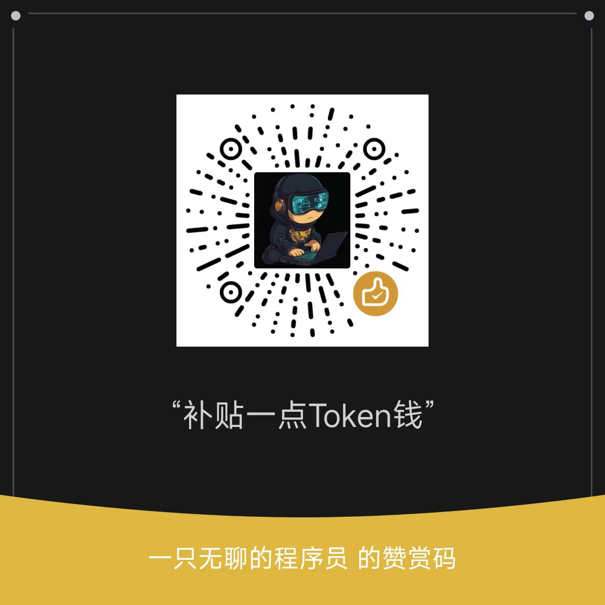

# 写在前面

本项目在https://github.com/wujunjiesd/tsl-esp-c项目上迭代，同时参考如下代码：

- **特斯拉官方 Go SDK**：https://github.com/teslamotors/vehicle-command
- **ESP-IDF 官方示例**：https://github.com/espressif/esp-idf/tree/master/examples

编译与烧录方式与 ESP-IDF 官方示例一致，可先按 [ESP-IDF 入门](https://docs.espressif.com/projects/esp-idf/zh_CN/latest/esp32s3/get-started/) 配置环境后再编译运行。

当前仓库已适配 **Waveshare ESP32-S3-Touch-LCD-3.49-V2**（参考 [xiaozhi-esp32](https://github.com/78/xiaozhi-esp32) 的同型号板级配置）。

---

# Tesla BLE 仪表 · ESP32-S3-Touch-LCD-3.49-V2

通过 BLE 连接特斯拉车辆，实时读取驾驶数据，在 172×640 竖屏上以卡片式仪表显示功率、车速、档位、里程等信息。

## 功能特性

- **免配置首次使用** — VIN 不再写死。VIN 为空时设备自动开启 WiFi 热点，
  用手机/电脑打开网页即可填写 VIN，保存后自动重启进入工作状态
- **短按电源键** — 息屏 / 亮屏（息屏时蓝牙仍在工作，点亮即恢复显示）
- **长按电源键 2.5 秒** — 关机（关闭背光 + 释放电源自锁 + 进入深度睡眠），
  再次按下电源键即开机
- **长按复位键（BOOT）5 秒** — 清空 VIN、车机连接密钥与配对状态，重启后
  自动进入配网模式，屏幕提示用 WiFi 重新设置 VIN
- **左右滑动屏幕** — 在「驾驶页（仪表盘）/ 车钥匙页」之间切换；息屏状态下触摸可点亮屏幕
- **BLE 通信** — NimBLE Central，ECDSA P-256 + ECDH + AES-GCM 认证
- **Protocol Buffers** — protobuf-c，与 vehicle-command Go SDK 协议一致
- **断线重连** — 连续失败若干次后自动重新配对
- **NVS 持久化** — VIN、私钥、配对状态持久保存

### 屏幕内容

| 页面 | 内容 |
|------|------|
| 驾驶页 | 车速表盘 (km/h)、档位、车门/后备箱/前备箱/充电口/胎压/告警 六格状态卡、功率读数 (kW) |
| 车钥匙页 | 4 个可配置按钮（左右滑动切换进入） |
| 配网页 | 热点名称、访问地址 192.168.4.1、VIN 填写指引 |

### 可读取的车辆状态

协议层已支持：驾驶（档位/车速/功率/里程/导航）、车身（锁定/睡眠/门窗/充电口）、
充电、空调、GPS、胎压、软件版本等。当前仪表界面使用其中的驾驶数据。

## 硬件

- **MCU**：ESP32-S3（N16R8：16MB Flash + 8MB OCT PSRAM，PSRAM 为屏幕帧缓存必需）
- **显示屏**：AXS15231B 172×640 QSPI IPS
- **触屏**：AXS15231B 触摸通道（I2C，0x3B）
- **扩展 IO**：TCA9554（I2C，0x20），控制屏幕复位、背光使能、电源自锁
- **按键**：电源键 GPIO16、BOOT/RESET 键 GPIO0

### 引脚（板载固定）

**V2（默认，本项目目标板）**

| 功能 | GPIO |
|------|------|
| LCD CS / PCLK / D0 / D1 / D2 / D3 | 9 / 10 / 11 / 12 / 13 / 14 |
| LCD 背光亮度（低电平点亮） | 42 |
| LCD 复位 / 背光使能 / 电源自锁 | TCA9554 EXIO5 / EXIO1 / EXIO6 |
| 主 I2C（TCA9554）SDA / SCL | 47 / 48 |
| 触摸 I2C SDA / SCL | 17 / 18 |
| 电源键 | 16 |
| BOOT 键 | 0 |

**旧版 3.49（与 V2 的差异）**：LCD 复位是 GPIO21，背光是 GPIO8，
其余引脚相同。编译时加 `-DBOARD_HW_VER=1` 切换：

```bash
idf.py -DBOARD_HW_VER=1 build
```

程序启动时还会自动检查 TCA9554 是否存在：如果按 V2 编译却找不到扩展 IO，
会自动回退到旧版引脚并打印日志，避免屏幕全黑。

引脚定义集中在 `components/board/include/board_config.h`。

> **关于两个按键**：板上标注 `RESET` 的键直接接芯片 EN，按下就是硬件复位，
> 软件完全感知不到；**长按清除配置请用标注 `BOOT` 的键**（或按住 BOOT 再点 RESET 并保持 5 秒）。

## 项目结构

```
tsl-esps3-c/
├── CMakeLists.txt               # 排除旧板型（C3 圆形表盘）遗留组件
├── partitions.csv               # 16MB Flash：NVS 64KB + 4MB app
├── sdkconfig.defaults           # esp32s3 / 8MB OCT PSRAM / NimBLE / SoftAP
├── main/
│   └── main.c                   # 主流程：配网模式 / 配对 / 连接 / 轮询
├── components/
│   ├── board/                   # 板级初始化：I2C、TCA9554、电源自锁、屏幕复位
│   ├── settings/                # NVS 配置：VIN、私钥、配对状态
│   ├── lcd_display/             # AXS15231B 驱动 + 触摸 + 仪表 UI
│   │   ├── lcd_display.c        # QSPI 屏、PSRAM 帧缓存、DMA 刷屏、渲染任务
│   │   ├── ui_draw.c            # 绘图基元（矩形/圆角/圆形/4bpp 抗锯齿文字）
│   │   ├── ui_pages.c           # 驾驶页 / 车钥匙页 / 配网引导页
│   │   └── fonts/               # 自动生成的字库（勿手改）
│   ├── power_ctrl/              # 电源键：短按息屏/亮屏、长按关机
│   ├── boot_button/             # 复位键：长按 5 秒清除配置
│   ├── wifi_portal/             # 配网门户：SoftAP + HTTP + DNS 劫持
│   │   └── assets/index.html    # 配置网页（编译时嵌入）
│   ├── tesla_ble/               # 特斯拉 BLE 与协议
│   ├── power_gauge/             # （旧板型遗留，已排除编译）
│   └── decode_image/            # （旧板型遗留，已排除编译）
└── tools/
    ├── gen_fonts.py             # 生成中英文字库（4bpp 抗锯齿）
    ├── check_text_width.py      # 检查界面文案是否超宽
    ├── build.sh                 # 带 IDF 环境的编译脚本
    └── preview/                 # PC 端界面预览（PPM 输出，可选）
```

## 编译与烧录

### 前置要求

- ESP-IDF v5.3+（本项目在 v5.5.3 下验证编译通过）
- 目标芯片：ESP32-S3（16MB Flash + 8MB PSRAM）

### 生成 Protocol Buffers 代码（首次或修改 proto 后）

```bash
cd components/tesla_ble/proto
./gen_proto.sh
cd ../../..
```

### 编译与烧录

```bash
. $IDF_PATH/export.sh
idf.py set-target esp32s3     # sdkconfig.defaults 已指定 esp32s3
idf.py build
idf.py -p /dev/ttyUSB0 flash monitor
```

也可以直接使用封装脚本（自动加载本机 IDF 环境）：

```bash
./tools/build.sh build
./tools/build.sh -p /dev/ttyUSB0 flash monitor
```

> 若手上的板子 Flash 不是 16MB，请修改 `sdkconfig.defaults` 中的
> `CONFIG_ESPTOOLPY_FLASHSIZE_16MB` 与 `partitions.csv`。

### 注意事项

**1. 切换 ESP-IDF 版本后编译报错**

如果本地装有多个 IDF 版本（如 v5.5.3 和 v6.1）。若 `build/` 目录是用另一个版本生成的，
编译会在 bootloader 配置阶段报：

```
CMake Error: The source ".../v5.5.3/esp-idf/components/bootloader/subproject/CMakeLists.txt"
does not match the source ".../v6.1/esp-idf/..." used to generate cache.
```

解决：删除旧的构建产物后重新配置（`flash.sh` 使用 v5.5.3）：

```bash
rm -rf build sdkconfig dependencies.lock
idf.py set-target esp32s3
```

**2. IDE 的 "Build, Flash and Monitor" 任务烧写失败**

ESP-IDF 扩展默认可能配置为 JTAG 烧写，任务会启动 OpenOCD 然后连接失败
（编译本身是成功的，日志已生成镜像）。检查 `.vscode/settings.json`：

- `idf.flashType` 应为 `UART`（esptool 串口烧写）
- `idf.port` / `idf.monitorPort` 设为实际串口（如 `/dev/cu.usbmodem1101`）
- `idf.currentSetup` 与 `flash.sh` 使用的 IDF 版本一致（v5.5.3）

修改后需 Reload Window 生效。也可以直接用 `./flash.sh` 绕开 IDE 任务，
它对 USB-JTAG 口（`usbmodem*`）已做 `--before usb_reset` 处理，
可避免 esptool "Failed to connect"。

## 使用流程

```
上电
 │
 ├─ 板级初始化（立即拉高电源自锁，松开电源键不会断电）
 ├─ 屏幕 / 触摸 / 按键 / 电源键任务
 │
 ├─ NVS 中没有 VIN ?
 │    └─ 配网模式：开热点 → 屏幕显示热点名与 192.168.4.1
 │         └─ 手机连接热点 → 浏览器打开 192.168.4.1 → 填 VIN → 保存 → 自动重启
 │
 └─ 有 VIN
      ├─ 加载/生成私钥
      ├─ 未配对 → 扫描 → 连接 → AddKeyRequest → 车机确认 + NFC 卡 → 记录配对状态
      └─ 已配对 → 扫描 → 连接 → 服务发现 → ECDH 会话
                  → 每 100ms 读取驾驶数据 → 刷新仪表
                  → 断线自动重连（连续失败 3 次则重新配对）
```

### 首次配网

1. 设备上电后屏幕显示「未设置车辆VIN」与热点名称（`TeslaDash-XXXX`）
2. 手机 WiFi 连接该热点（**无密码**）
3. 浏览器访问 `http://192.168.4.1/`（多数手机会自动弹出配置页）
4. 输入 17 位 VIN 并保存，设备自动重启
5. 重启后自动进入蓝牙配对流程，在车机屏幕确认并把 NFC 卡放在中控台

VIN 可在行驶证、前挡风玻璃左下角或车辆中控「软件」页面查看。

### 按键操作

| 操作 | 效果 |
|------|------|
| 短按电源键 | 息屏 / 亮屏 |
| 长按电源键 2.5 秒 | 关机（电池供电时断电，USB 供电时进入深度睡眠） |
| 短按 BOOT 键 | 无动作（避免误触） |
| **长按 BOOT 键 5 秒** | 清除 VIN + 密钥 + 配对状态，屏幕切到配网引导页，**松开按键后**自动重启进入配网模式 |
| 左右滑动屏幕 | 切换「驾驶页（仪表盘）/ 车钥匙页」 |
| 轻触屏幕 | 车钥匙页：触发按钮；息屏时点亮屏幕 |

> 清除配置后必须**先松开 BOOT 键**再重启：如果复位瞬间 BOOT 仍被按住，
> 芯片会进入 ROM 下载模式，表现为黑屏无反应。程序已做等待松开的处理。

> 「开机」由硬件完成：按下电源键时电源自锁电路上电，ESP32-S3 启动后立即
> 通过 TCA9554 EXIO6 拉高自锁。若在 USB 供电下关机（深度睡眠），
> 按下电源键会通过 EXT1 唤醒，等效开机。

## 配置

所有用户配置通过网页写入 NVS（命名空间 `tesla_cfg`），不再需要改代码：

| 键 | 说明 |
|----|------|
| `vin` | 17 位 VIN |
| `priv_key` | 车机配对私钥（32 字节） |
| `paired` | 配对状态 |
| `ap_name` | 自定义热点名（可选，默认 `TeslaDash-XXXX`） |

时间参数在 `main/main.c` 顶部：

```c
#define POLL_INTERVAL_MS      100     // 驾驶状态轮询间隔
#define CONNECT_TIMEOUT_MS    30000   // 连接/服务发现超时
#define RECONNECT_DELAY_MS    5000    // 重连延迟
#define MAX_CONNECT_FAILURES  3       // 连续失败后重新配对
#define PAIRING_WAIT_SEC      60      // 等待车机确认配对的时长
```

## 界面与字库

- 屏幕为 172×640 竖屏，采用卡片式纵向布局；配色为深色底 + 绿色/蓝色区分
  （绿色 = 驱动功率，蓝色 = 动能回收，橙色 = 大功率 / 倒挡）
- 帧缓存放在 PSRAM（约 215KB），渲染完成后按 32 行条带拷入内部 DMA 缓冲推送，
  刷新率限制在 10 fps 以降低 CPU 占用
- 字库由 `tools/gen_fonts.py` 从系统 TTF 生成 4bpp 抗锯齿位图，
  中文字符集**自动扫描 `components/` 下源码中的中文**，新增文案后重新执行：

```bash
python3 tools/gen_fonts.py       # 需要 Pillow，且需要 macOS 自带字体
python3 tools/check_text_width.py   # 检查文案是否超出卡片宽度
```

- 可选：在 PC 上预览界面排版（需要本机有 clang/gcc）

```bash
./tools/preview/preview.sh       # 生成 tools/preview/preview_*.png
```

## 技术细节

### BLE 通信

- NimBLE 协议栈，Central 角色，单连接
- Tesla Service UUID: `00000211-b2d1-43f0-9b88-960cebf8b91e`
- Write Characteristic: `00000212-...`（发送命令）
- Read/Notify Characteristic: `00000213-...`（接收响应）
- 首选 MTU 512

### 协议

- 使用 **protobuf-c** 生成 C 代码，与 [vehicle-command](https://github.com/teslamotors/vehicle-command) Go SDK 的 proto 定义对齐
- 消息格式：2 字节长度前缀 + RoutableMessage
- 认证：AES-GCM 加密 + HMAC-SHA256
- 密钥交换：ECDH secp256r1
- 防重放：车辆提供的 epoch + counter + 消息过期时间
- 车速字段车辆上报单位是 **mph**，界面显示时换算为 km/h

### 配网门户

- SoftAP（无密码，SSID `TeslaDash-XXXX`，由 MAC 后两字节生成）
- `esp_http_server` 提供 `/`、`/api/status`、`/api/vin`
- 内置 DNS 劫持（UDP 53，任意域名解析到 192.168.4.1），配合
  `/generate_204`、`/hotspot-detect.html` 实现强制门户，手机连上后一般会自动弹出页面
- 保存 VIN 后延时 1.2 秒重启，重启即进入正常工作流程

### 显示

- AXS15231B QSPI（40 MHz），RGB565，发送前做字节交换
- 屏幕复位与背光使能由 TCA9554 控制；背光在首帧推送完成后再点亮，避免闪花屏
- 触摸使用 `esp_lcd_touch` 轮询（25ms），用于左右滑动切模式、按键与点亮屏幕

## 故障排查

### 屏幕不亮

先看串口日志，正常启动应依次出现：

```
I (xxx) BOARD: I2C0(47/48) 上的 I2C 设备: 20
I (xxx) BOARD: 电源自锁已开启 (EXIO6=1)
I (xxx) BOARD: 板级初始化完成 (HW_VER=2, 背光 GPIO42)
I (xxx) LCD: PSRAM 可用: xxxxx 字节, 内部 RAM 可用: xxxxx 字节
I (xxx) LCD: 帧缓存 220160 字节 @0x3C......
I (xxx) LCD: 面板初始化完成 172x640
W (xxx) LCD: 背光硬件 -> 开
```

- **没有第一行 / 没有 0x20 设备**：TCA9554 没通信上。检查 I2C 是否被其它外设占用，
  或板子其实是旧版（此时会自动回退到 GPIO8/GPIO21，见日志提示）。
- **没有“电源自锁已开启”**：同上，扩展 IO 不可用；电池供电时设备会随松键断电。
- **PSRAM 可用为 0**：PSRAM 未初始化（板子可能是四线 PSRAM）。程序已配置
  `CONFIG_SPIRAM_IGNORE_NOTFOUND` 不会重启，但建议核对 `sdkconfig.defaults` 的
  `CONFIG_SPIRAM_MODE_OCT`。
- **有背光但无画面**：说明供电/背光正常，问题在 QSPI 数据通路（引脚或面板初始化）。
  背光在初始化最开始就会点亮，所以“有背光”是判断 MCU 已启动的标志。

### 长按 BOOT 没反应 / 清不掉配置

1. 确认按的是 **BOOT 键**，不是 RESET（RESET 直接复位芯片，软件无法感知）。
2. 需要**按住 5 秒**（2 秒时屏幕会提示“按住将清除配置”）。
3. 清除完成后要**松开按键**，程序会等松开再重启；若一直按住会停在等待里（30 秒后强重启）。
4. 若设备此前进了 ROM 下载模式（黑屏、串口无日志），断电重上电即可恢复。

## 参考资料

- [Tesla Vehicle Command SDK](https://github.com/teslamotors/vehicle-command)
- [xiaozhi-esp32 板级配置](https://github.com/78/xiaozhi-esp32)
- [ESP-IDF NimBLE 示例](https://github.com/espressif/esp-idf/tree/master/examples/bluetooth/nimble)
- [esp_lcd_axs15231b](https://components.espressif.com/components/espressif/esp_lcd_axs15231b)

## 赞赏

如果这个项目对你有帮助，欢迎扫码请作者喝杯咖啡。


